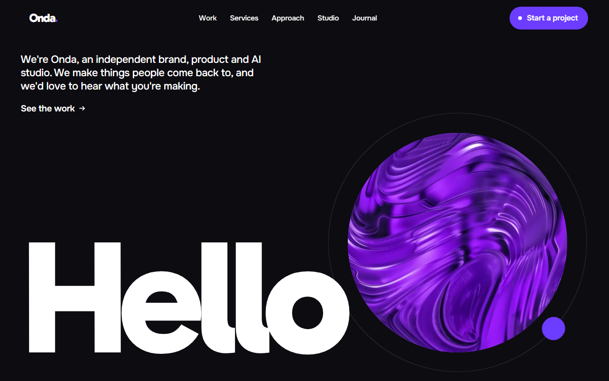
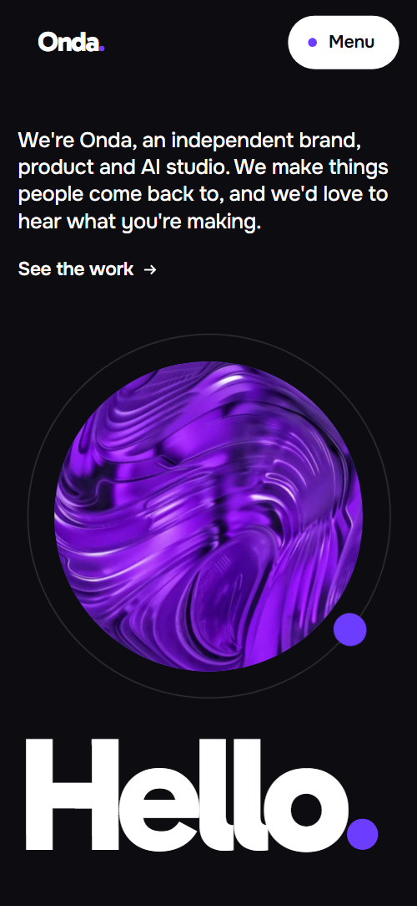
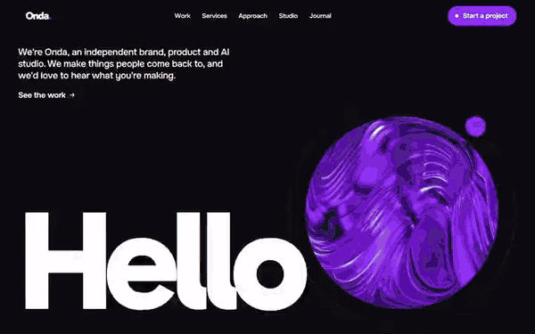

# Free HTML design studio website template with GSAP scroll animations

Design studio website template: one free HTML file for a brand, product or digital agency, with ten sections from a one-word greeting to a contact form, plus a fixed navigation bar and a footer. The look is black, white and one violet, with giant type and a round photo that travels down the page as you scroll. AGENTS.md is included, so Claude Code, Cursor or Codex can adapt it to your studio.

[](LICENSE)  

**[Live demo](https://8bsite.github.io/design-studio-website-template/)** · **[Use this template](https://github.com/new?template_name=design-studio-website-template&template_owner=8bsite)** · **[Download ZIP](https://github.com/8bsite/design-studio-website-template/archive/refs/heads/main.zip)** · **[Template page on 8b.com](https://8b.com/templates/onda/)**

<a href="https://8bsite.github.io/design-studio-website-template/"></a> <a href="https://8bsite.github.io/design-studio-website-template/"></a>

<p align="center"><a href="https://8bsite.github.io/design-studio-website-template/"></a><br><sub>Scroll animation</sub></p>

## Use it with Claude Code, Cursor or Codex

Download the four files into your project folder (`curl.exe` in Windows PowerShell):

```bash
curl -LO https://raw.githubusercontent.com/8bsite/design-studio-website-template/main/index.html
curl -LO https://raw.githubusercontent.com/8bsite/design-studio-website-template/main/AGENTS.md
curl -LO https://raw.githubusercontent.com/8bsite/design-studio-website-template/main/LICENSE
curl -LO https://raw.githubusercontent.com/8bsite/design-studio-website-template/main/CREDITS.md
```

Then fill in the angle brackets and give your agent this prompt:

```text
Read AGENTS.md, then edit index.html. Make it the site for <your studio: name, what you make and for whom, offices, contacts, client projects and results, long term clients, services, how a project starts and is priced, team size and open roles>. Replace the studio name, the statement, the case cards and the client wheel first. Keep the section ids, the class names AGENTS.md lists, the dot span in each section heading, the length number on Hello and Let's talk, four process steps for the four ring stations, five collage photos, one journal photo per story. Ask me for missing facts and never invent clients, results, rates, addresses or contacts.
```

For vibe coding with Claude Code, Cursor or Codex, the first edits are the studio name, the two-line statement, the five case cards and the six long-term clients, because every client and result in the demo is invented. Keep these counts in step: four process steps for the four ring stations, five photos in the desktop collage (each has its own position), and one frame photo per journal story, in the same order. Have the agent ask you for real offices, addresses, phone numbers, team size, rates and open roles instead of guessing.

No agent? Click **[Use this template](https://github.com/new?template_name=design-studio-website-template&template_owner=8bsite)**, edit `index.html` on GitHub and turn on **Settings > Pages**.

## Sections and motion

- **Navigation**: fixed top bar: wordmark, section links, Start a project button; phone menu overlay.
- **First screen**: first screen: a one-word greeting whose full stop is a giant round photo (demo: "Hello"). Smooth scrolling runs page-wide; headings rise as their dot drops in. Scrolling away carries the round Hello photo down into the next heading's dot.
- **We make the things people come back to**: two-line statement of what the studio does, a lead paragraph and an index of links into the page. Tied to scroll, the two heading lines slide up, the dot pops in, and the lead darkens word by word.
- **Selected work**: case studies: five large cards on a horizontal track (demo: five client launches). Pinned, five case cards slide sideways with photos panning inside them, then bend onto a curve as the section ends.
- **Never a one-off**: long-term clients: six cards on a wheel that turns with scroll (demo: years of partnership). Pinned, six client cards ride the rim of a large wheel that swings into place and turns as you scroll.
- **What we do**: services: five cards that stack as you scroll, each with deliverable badges and a photo. Service cards stick and stack, each shrinking and darkening under the next; photos open from a circle as they appear.
- **How we work**: process: four steps beside a ring the scroll draws round (demo: Listen, Make, Measure, Again). Tied to scroll, a violet arc draws round the sticky ring and each station dot pops as its step brightens.
- **Inside the studio**: team and careers: photo collage that deals out from a pile, with open roles. Tied to scroll, the collage photos start as a tilted pile in the centre and deal out to their places.
- **Ideas and news**: news and articles: four stories beside a sticky photo frame. The photo frame stays put while stories pass; each brightens on arrival and its photo opens in a circle.
- **Fair questions**: questions and answers (native &lt;details&gt;).
- **Let's talk**: violet contact field: big "Let's talk", email, two offices with phones, and a form (placeholders). As the violet section scrolls in, Let's talk grows from regular to extra bold, then its white dot drops in.
- **Footer**: closing greeting "Bye" with the round photo full stop, link columns, newsletter, copyright and the Design: 8B credit. Tied to scroll, Bye rises while its full stop grows from a dot into a large round photo.

## Design

 near-black bands and text  
 white bands, text on black  
 violet dots, buttons, process ring, contact section  
 pale cards for services and the form  
 muted text on black  
 secondary text on white  
 dark base under photos

**Gabarito**: extra bold, tightly tracked headings; Hello and Bye are single giant words sized in viewport units (Hello also from its character count on phones), and Let's talk is sized from its character count to fill the width. **Onest**: body, labels, buttons and badges (Google Fonts). Black, white and one violet. Every section heading ends in a round violet dot, echoed by the round photo full stops after Hello and Bye and the dot in each pill button. Cards have large rounded corners, studio photos form a scattered collage, and form fields are bare underlines.

## Questions

**Does it work as a design agency website if we do not do AI work?**  
Yes. Case studies, long-term clients, services, process, team and journal suit any agency, so it also works as a digital agency template. Rewrite the hero line, the title and meta description, and delete or rewrite the Applied AI card, then update the Five practices lead.

**Do the contact form and the newsletter field send anything?**  
No, not yet. Both check what was typed and show a thank-you or error message, but nothing leaves the page until you connect a service such as Formspree or Netlify Forms. Without a service, remove the form together with its script and keep the email link.

**Do the case cards link to pages?**  
No, not yet. The five case cards and the four journal stories are plain list items, not links. A design studio site usually wants each card to open its own case-study page, so wrap each card in a link to yours. The footer Instagram, LinkedIn and Vimeo links go to those networks' home pages until you change them.

## Is it the right base?

Pick this base for a design studio website when the proof is a handful of strong projects and the page itself should feel designed. If you describe yourselves as a creative agency or a production house, the [production house](https://8b.com/templates/sillage/) template is the nearer match. The weak spot is depth: everything lives on one page, so a studio with dozens of projects needs a separate portfolio, and with motion allowed the work section pins for a long sideways scroll that some visitors will find slow.

## Before you publish

- Replace what is marked `data-8b-placeholder` (social preview image, favicon, email, phone, form, social) and the invented demo facts; [AGENTS.md](AGENTS.md) lists them.
- The form sends nothing yet: connect it to Formspree or Netlify Forms, or remove it.

## Tech

GSAP 3.13.0, ScrollTrigger, Lenis 1.3.4 from jsDelivr, 135 KB, no build step. Chrome and Edge 111+, Safari 16.2+, Firefox 113+ (it uses color-mix(), cascade layers, small/dynamic viewport units). With "reduce motion" on, the page is complete and still.

## License

MIT, see [LICENSE](LICENSE). Photos, fonts and libraries keep their own licences: [CREDITS.md](CREDITS.md). More free templates: [8b.com/templates](https://8b.com/templates/) · [github.com/8bsite](https://github.com/8bsite).
